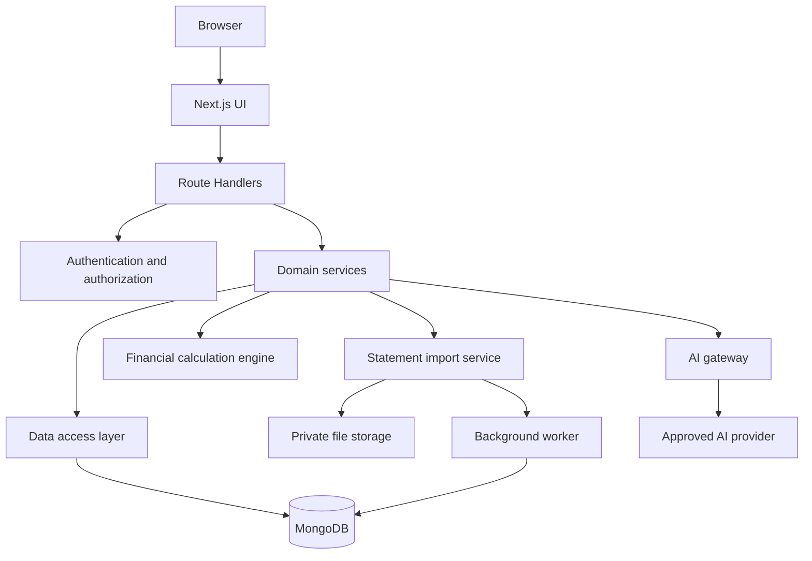

# PaisaPilot — System Architecture

## Purpose
Define the system boundaries and implementation architecture for PaisaPilot, an AI-powered personal finance platform. The MVP uses manual entry and tested statement imports; live bank integration is a later, separately verified capability.

## Recommended stack
- Next.js App Router, React, TypeScript
- Tailwind CSS and accessible shared UI components
- MongoDB Atlas with validation and indexes
- Maintained authentication library with secure server-side sessions
- Zod or equivalent runtime validation
- Private object storage for uploaded statements
- Background worker/queue for imports and scheduled jobs
- Server-side AI provider adapter
- Unit, integration, and end-to-end tests
- Managed deployment, monitoring, backups, and secret management

## Logical architecture


## Suggested structure
```text
src/
  app/                 # routes, layouts, route handlers
  components/ui/       # shared accessible components
  features/            # auth, transactions, imports, budgets, reports
  lib/                 # validation, money, auth, database, security
  server/services/     # domain logic
  server/repositories/ # database access
  server/integrations/ # AI, storage, notifications
  workers/             # import and scheduled jobs
  tests/               # unit, integration, end-to-end tests
```

## Core flows
### Transaction creation
1. Authenticate the user and validate input on the server.
2. Verify the account and category belong to that user.
3. Normalize money to integer paise or a documented exact-decimal type.
4. Persist the transaction and update/invalidate derived summaries.
5. Return the record and stable ID.

### Statement import
1. Validate file type, size, and contents.
2. Store the file privately and create an import job.
3. Parse and normalize rows in a resource-limited worker.
4. Present preview, warnings, and duplicate candidates.
5. Commit only after user confirmation.
6. Make commits idempotent and report row-level outcomes.

### AI request
1. Authenticate and rate-limit.
2. Fetch a bounded set of server-calculated metrics for the requested period.
3. Send only minimum necessary context to the AI provider.
4. Validate the model response against a schema.
5. Show assumptions, period, and data coverage.

## Security and ownership
- Derive `userId` from the verified session, never trust a client-provided owner ID.
- Scope every user-owned read, update, delete, export, and background job by owner.
- Keep secrets server-only and out of logs.
- Protect uploads against oversized/malformed files and parser abuse.
- Treat transaction descriptions and imported documents as untrusted data.
- Do not request bank passwords, UPI PINs, card PINs, or OTPs.
- Do not allow the LLM arbitrary database queries or code execution.

## Reliability
- Paginate transaction lists and index frequent filters, including user and date.
- Use bounded retries, timeouts, and idempotency for external services and jobs.
- Do not call statement-derived balances live bank balances.
- Use one tested financial calculation module for dashboard, reports, and AI context.

## Future bank integration
Do not assume a public SBI transaction API is available. Verify provider eligibility, consent, legal/regulatory requirements, data minimization, revocation, and contractual terms before implementing any connector.
