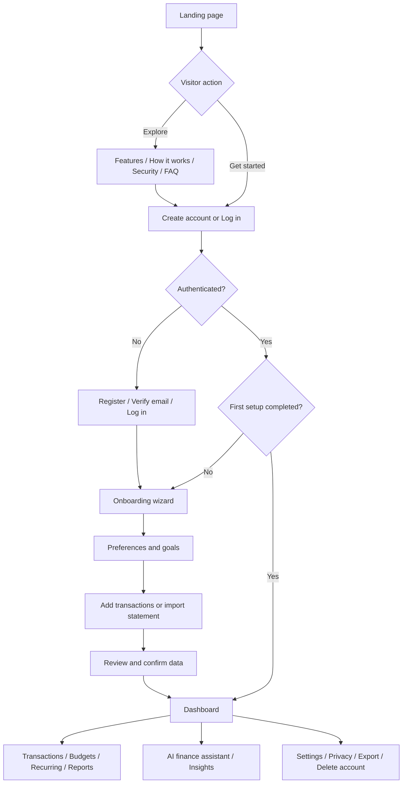
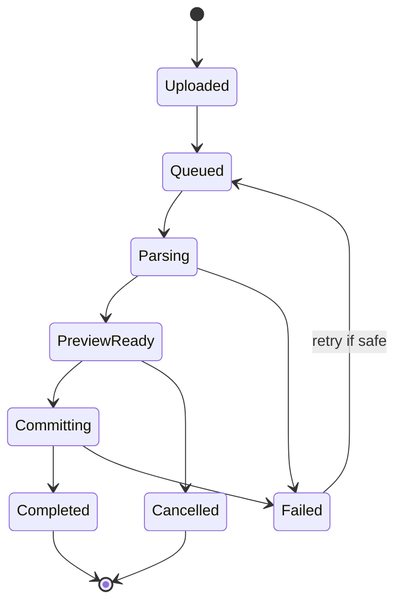
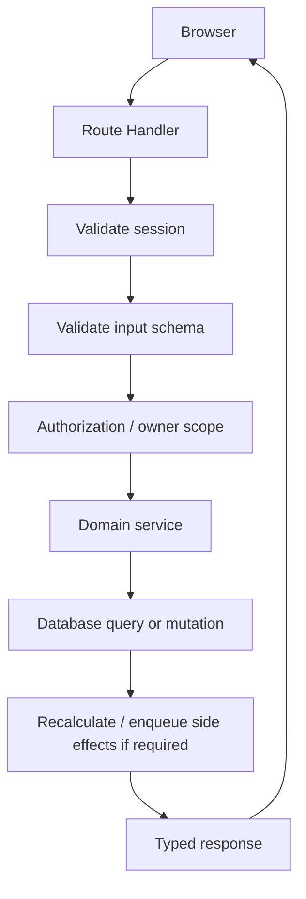
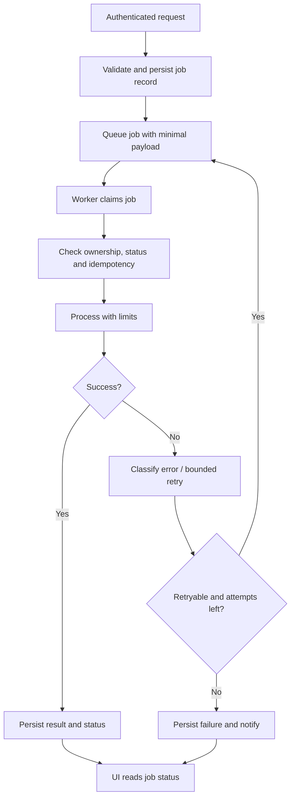

# PaisaPilot — Full Application Workflow

**Document type:** End-to-end product, user journey, screen map, and implementation workflow  
**Product:** PaisaPilot — AI-powered personal finance intelligence  
**Platform:** Responsive web application  
**Initial market:** India  
**Primary data sources in MVP:** Manual entry and user-uploaded CSV / supported SBI PDF statements  
**Related specifications:** `prd.md` (product requirements) and `trd.md` (technical requirements)

---

## 1. Purpose and Product Rule

This document describes the complete path a user takes from the public landing page through registration, first-time setup, daily use, statement imports, budgets, AI insights, reports, account settings, and account deletion. It also maps the key backend workflows and recommended build order.

**Core product rule:** establish trustworthy financial data first, then provide analytics, then add AI explanations and forecasts. AI must never invent balances, transactions, or bank connectivity. The first release is a finance tracker and insight tool, not a payment processor or investment-advice service.

## 2. Main Application Journey

### Returning user path

1. User opens PaisaPilot and selects **Log in**.
2. Authentication provider validates credentials and establishes a secure session.
3. Server checks the session and onboarding status.
4. User lands on the Dashboard, normally with the last-used date range preserved.
5. Dashboard cards display the latest calculated data and its source/freshness context.
6. User opens a specific workflow, such as adding a transaction, importing a statement, reviewing a budget, or asking the AI assistant a question.
7. When data changes, the affected totals and reports refresh from server-calculated data.

## 3. Sitemap and Route Plan

Route names are recommendations. Keep the implementation consistent if the existing repository already uses different conventions.

### Public routes

| Route | Page purpose | Main actions |
|---|---|---|
| `/` | Landing page | Get Started, Log In, explore features |
| `/features` | Feature overview | Learn about tracking, imports, budgets and AI |
| `/how-it-works` | Workflow explanation | Understand setup, statement import and insights |
| `/security` | Security and privacy explanation | Read data-handling principles and limitations |
| `/faq` | Common questions | Learn supported imports, AI limits and account controls |
| `/privacy` | Privacy notice | Understand collection, use, retention and deletion |
| `/terms` | Terms of use | Read product boundaries and user responsibilities |
| `/login` | Login | Authenticate, recover account |
| `/register` | Registration | Create an account |
| `/verify-email` | Email verification state | Verify or resend verification message |
| `/forgot-password` | Password recovery request | Request recovery link without disclosing account existence |
| `/reset-password` | Set a new password | Complete time-limited password reset |

### Authenticated application routes

| Route | Primary screen | Core capability |
|---|---|---|
| `/app` or `/dashboard` | Overview | Income, expense, cash flow, category breakdown, recent transactions |
| `/app/transactions` | Transaction ledger | Search, filter, sort, paginate and manage entries |
| `/app/transactions/new` | Add transaction | Record income or expense manually |
| `/app/transactions/[id]` | Transaction details/edit | Review or update an owned transaction |
| `/app/imports` | Statement import center | Upload, preview, commit, retry and review import history |
| `/app/imports/new` | New import flow | Select source/file and upload safely |
| `/app/imports/[id]` | Import details | Review import status, row counts and errors |
| `/app/accounts` | Payment sources | Manage bank accounts, cards, cash and UPI labels; no credentials stored |
| `/app/categories` | Categories | Manage category list and transaction mappings |
| `/app/budgets` | Budget overview | Compare spending against targets |
| `/app/budgets/new` | Create budget | Define category, limit and time period |
| `/app/budgets/[id]` | Budget details | Progress, history and edit options |
| `/app/recurring` | Recurring payments | Review detected patterns and confirmed recurring items |
| `/app/insights` | Financial insights | Explain trends and notable changes from actual data |
| `/app/assistant` | AI finance assistant | Ask questions about the user's available financial data |
| `/app/reports` | Reports | Review and export period/category reports |
| `/app/notifications` | Notification center | Review alerts and mark them read |
| `/app/settings/profile` | Profile | Update display name and preferences |
| `/app/settings/preferences` | Preferences | Currency display, timezone and notification choices |
| `/app/settings/security` | Security | Session controls and available authentication options |
| `/app/settings/data` | Data controls | Export personal data and inspect connected sources/import history |
| `/app/settings/privacy` | Privacy controls | Start data deletion and view retention details |
| `/app/help` | Help | Troubleshooting, supported statement formats and support contact |

**Optional future route:** `/app/settings/bank-connections` should only become active when a verified, eligible, authorized bank-data provider has been selected and approved for the deployment. Do not show fake “connected live bank” states in the MVP.

## 4. Global Layout and Navigation

### Public layout

- Logo and product name: PaisaPilot.
- Primary navigation: Features, How it works, Security, FAQ.
- Primary actions: Log In and Get Started.
- Footer: Privacy, Terms, Help, contact/support, and clear product limitations.
- Responsive mobile navigation with visible keyboard focus and accessible labels.

### Authenticated layout

- Desktop: collapsible sidebar, top bar, page title, date-range controls where relevant, and main content area.
- Mobile: compact header and accessible navigation drawer/bottom navigation; key tasks such as Add Transaction and Import Statement must remain reachable.
- Shared top bar: account menu, notification indicator, help link and current workspace/profile label.
- Sidebar order recommendation: Overview, Transactions, Import Statements, Budgets, Recurring Payments, Insights, AI Assistant, Reports, Payment Sources, Categories, Settings.
- A page must never rely on color alone to convey expense, income, warning, or success.
- All data views need loading, empty, partial-data, error, and success states.

## 5. Landing Page: Section-by-Section Workflow

### 5.1 Hero section

**Headline concept:** “Understand your money. Make clearer financial decisions.”  
**Supporting text:** Track spending, import supported bank statements, manage budgets and discover patterns in one private workspace.

Primary CTA: **Get Started** → `/register`  
Secondary CTA: **See How It Works** → `/how-it-works`

Avoid claims such as guaranteed savings, live access to every bank, perfect predictions, or “bank-grade” security unless those claims are substantiated and reviewed.

### 5.2 Problem and value proposition

Explain the user problem in plain language: spending data is scattered across accounts, UPI, cards and cash; categorization takes time; month-to-month patterns are hard to see.

Show the intended outcome: a consolidated personal view based on transactions the user manually enters or chooses to import.

### 5.3 Feature preview

Introduce the real product modules:

- Transaction tracking and categorization.
- CSV and specifically supported PDF statement imports.
- Monthly budgets and budget progress.
- Spending breakdowns and historical reports.
- AI-assisted categorization and grounded financial Q&A.
- Recurring payment detection and transparent cash-flow estimates.

Every card should link to a feature explanation, not pretend the visitor's data is already available.

### 5.4 How it works

1. Create an account.
2. Add transactions manually or upload a supported statement.
3. Review the imported rows and confirm them.
4. Review the dashboard, set budgets and explore insights.
5. Return regularly to keep records current.

### 5.5 Trust and privacy section

Explain that users control uploads, statements are parsed only through supported formats, and imported data is not the same thing as a guaranteed live bank balance. State that bank passwords, UPI PINs and OTPs are never requested by PaisaPilot.

### 5.6 FAQ and final CTA

Answer common questions about supported formats, data freshness, deleting uploads, AI limitations and account deletion. CTA routes to registration.

### 5.7 Landing page success criteria

- The visitor can understand the product and its limitations.
- Main CTA opens registration; login opens the login page.
- Landing page works on mobile, keyboard and screen reader workflows.
- No sensitive data or fabricated financial statistics appear in marketing mockups without being clearly marked as demo data.

## 6. Registration, Login and Session Workflow

### Registration

1. User enters display name, email and password, and accepts required terms.
2. Client validates obvious field errors; the server validates everything again.
3. Server normalizes the email, checks registration policy and applies rate limits.
4. Password is hashed with a suitable password-hashing algorithm through the auth library; plaintext passwords are never stored or logged.
5. If email verification is enabled, a short-lived verification token is issued and the UI explains the next step.
6. After successful verification/sign-in, create or load the user's profile and route to onboarding.

### Login

1. User submits credentials.
2. The auth layer checks credentials and rate limits.
3. A secure session is created, using secure cookie settings appropriate to production.
4. Server derives the user ID from the verified session, never from a client-supplied user ID.
5. Route to onboarding when incomplete; otherwise route to `/app`.

### Password recovery

1. User submits email address.
2. Return a neutral message that does not reveal whether an account exists.
3. If the account is eligible, send a one-time, short-lived reset link.
4. Validate token expiry and one-time use on the server.
5. Save the new password hash and invalidate relevant sessions where supported.
6. Notify the user of a password change without including sensitive tokens.

### Authenticated route guard

Each protected page and API endpoint must enforce authentication server-side. Hiding a button in the UI is not access control. Every database operation on personal data must scope the operation to the current user and the owned resource.

## 7. First-Time Onboarding Workflow

Keep onboarding short and skippable wherever the choice is not needed for safe operation. Do not request bank credentials.

### Step 1 — Welcome

Explain what setup unlocks and what the user can do immediately. Show progress such as “Step 1 of 4”.

### Step 2 — Preferences

Collect only useful initial preferences:

- Preferred currency display (default INR; currency storage policy must remain explicit).
- Timezone or date display preference when not safely inferred.
- Notification preferences.
- Optional monthly budget goal or savings goal, clearly labeled as optional.

Do not collect highly sensitive information without a clear product need.

### Step 3 — Choose a starting method

Offer three clear paths:

1. **Add transactions manually** → open Add Transaction.
2. **Import a statement** → open the Import Wizard.
3. **Explore demo mode** → use isolated synthetic demo data, visibly labeled as sample data.

Demo data must never be mixed with real user data. If true demo mode is not implemented, omit the option rather than simulating a working feature.

### Step 4 — First successful action

The onboarding checklist updates only after the backend confirms the selected action. Examples:

- First transaction saved successfully.
- First statement import committed successfully.
- Demo mode entered, if actually implemented.

### Step 5 — Completion

Route to the Dashboard. Keep a dismissible checklist for unfinished optional setup, such as creating a budget or reviewing categories.

## 8. Dashboard Workflow

### Layout and components

1. Page title: Overview.
2. Period selector: This month, last month, last 30 days, custom range.
3. Data freshness/source note: latest transaction date and whether data is manually entered, imported, or mixed.
4. KPI cards: income, expenses, net cash flow and budget progress where meaningful.
5. Cash flow chart: income and expense trends by day/week/month as appropriate.
6. Category spending chart with accessible labels and a list alternative.
7. Recent transactions list with category, date, amount, and source label.
8. Budget status and upcoming recurring items, if data exists.
9. Insights panel with evidence-backed summaries, not unsupported predictions.
10. Quick actions: Add Transaction, Import Statement, Create Budget, Ask Assistant.

### Dashboard data workflow

1. Server obtains the authenticated user's ID from the session.
2. Validate the selected period and timezone rules.
3. Query only the user's posted/active transactions for the period.
4. Apply one centralized financial calculation library.
5. Calculate totals, category groups and trend buckets on the server.
6. Return a typed response that includes period and data freshness metadata.
7. UI renders charts and accessible table/list alternatives.
8. On transaction/import/budget changes, revalidate affected queries or refresh the selected dashboard data.

### Partial or missing data

- No transactions: show a clear empty state with Add Transaction and Import Statement actions.
- Only one source: label it accordingly; do not suggest that all accounts are included.
- Older last transaction: show last recorded activity and explain that results may be incomplete.
- API failure: preserve page structure, show a retry action, and avoid displaying stale figures as fresh.
- No forecast evidence: do not show a forecast chart populated with invented sample values.

## 9. Transaction Management Workflow

### Transaction list

Filters: date range, income/expense, category, payment source, origin (manual/imported), and text search. Add pagination or cursor-based loading; do not load a user's whole history without bounds.

Each row shows date, description, category, payment source (if configured), origin, and amount. Clicking a row opens details/edit. Transaction actions must be keyboard accessible.

### Create transaction

Fields:

- Type: expense or income.
- Amount in INR (UI shows currency and precision rules).
- Date and, if supported, time.
- Description/merchant.
- Category.
- Payment source (optional when unknown).
- Optional notes/tags if included in the implementation scope.

Flow:

1. User opens Add Transaction.
2. Form defaults date safely and asks for transaction type.
3. Client validates required values for usability.
4. Server validates amount, date, category and payment source ownership.
5. Server stores a canonical transaction record with owner ID and provenance.
6. Server responds with the saved transaction.
7. UI displays success, closes or resets the form according to context, and refreshes ledger, dashboard and budget queries.

### Edit and delete

- Edit form is populated from the server-owned record.
- Server confirms record belongs to the authenticated user.
- Editing imported data retains import provenance; the original raw row/reference may remain for audit/reconciliation if policy requires it.
- Deletion uses a confirmation dialog, especially when it changes reports or budget totals.
- After mutation, revalidate derived metrics.
- If undo is implemented, it must be server-backed and time bounded; otherwise do not show an Undo action.

### Financial amount convention

Use one canonical model: signed integer paise (positive income, negative expense) or a documented amount-plus-direction model. Do not mix conventions. If amount and type are separate, all calculations must explicitly use type. Do not use JavaScript floating-point totals for authoritative financial calculations.

## 10. Bank Statement Import Workflow

The MVP supports user-controlled file upload for CSV and only the SBI PDF layouts that have been tested. Other bank formats must be marked unsupported until a parser is verified.

### Import wizard screens

**Screen A — Choose source**
- User selects supported file type and optional source account label.
- Explain allowed formats, maximum size, retention policy and privacy note.
- Do not ask for bank credentials or OTPs.

**Screen B — Upload and validate**
- Server validates extension, MIME/type signature where feasible, size, file content, malware scanning strategy and upload authorization.
- Store file in private temporary storage with random object keys.
- Create import record in `uploaded`/`queued` state.

**Screen C — Parse and normalize**
- Queue worker parses the file using a versioned parser adapter.
- Normalize dates, debit/credit amounts, descriptions, bank reference IDs and running balances when present.
- Detect header/footer rows, repeated headers, invalid rows and statement summary lines.
- Never mistake opening or closing balance lines for ordinary transactions.

**Screen D — Preview and mapping**
- Show detected account/source and date range where supported.
- Show parsed rows, row count, warnings, duplicate candidates and invalid rows.
- User can correct column mapping for CSV and exclude rows if needed.
- AI can suggest categories later, but it must not silently alter source amounts/dates.

**Screen E — Review duplicates and commit**
- Use bank reference ID when reliable; otherwise apply a source-scoped fingerprint plus review rules.
- Show uncertain possible duplicates for user review.
- User confirms commit.
- Server atomically records eligible transactions and import results, using idempotency keys or equivalent safeguards.

**Screen F — Result**
- Show imported count, skipped duplicates, rejected rows, warnings and supported date range.
- Link to the imported transactions and Dashboard.
- Provide a retry path for recoverable errors and a safe way to delete an import's imported records when allowed.

### Import state machine

### Import invariants

- Retrying a job must not create duplicate transactions.
- The user can only access their own import record and temporary file.
- A parser failure cannot partially commit unreviewed rows.
- The UI must distinguish “file uploaded”, “parsed”, “committed” and “failed”.
- Import completion is not a bank connection and does not guarantee a current bank balance.
- CSV formula injection must be mitigated in exported CSV files.
- Temporary files are deleted based on a documented retention policy.

## 11. Payment Sources and Categories

### Payment sources

Allow labels such as SBI Savings, another bank account, credit card, UPI, cash or custom source. Fields should be limited to what the product needs: display name, source type, optional masked/reference label, currency, and active state. Do not store bank login passwords, UPI PINs, OTPs, card security codes or full payment credentials.

A manually created “SBI Savings” payment source is a label, not proof that the source is connected to a live bank API.

### Categories

- Provide sensible default categories for income and expenses.
- Let users reassign a transaction category.
- User-defined categories should have an owner scope.
- Deleting a category should require a policy: reassign its transactions, archive it, or block deletion while in use. Do not silently orphan records.
- Category changes must refresh category reports, budgets and relevant insights.

## 12. Budget Workflow

### Create budget

Fields: budget name (optional), category or overall spending scope, limit, period (monthly/weekly/custom if supported), start date, and alert thresholds.

Flow:

1. User selects Create Budget.
2. Chooses category or total-expense scope.
3. Enters the limit and period.
4. Server validates positive amount, valid dates, duplicate/overlapping policy and ownership of category.
5. Budget is saved and shown in the budget overview.
6. Current spending is computed from eligible transactions in the budget period.

### Budget dashboard

- Limit, spent amount, remaining amount and percentage used.
- Time period and last update.
- Alert thresholds such as 80% and 100%, configurable by policy.
- Link to transactions contributing to the spend.
- Clear description of which transactions are included and whether imports are up to date.

### Budget alerts

- Create alert events idempotently when a threshold is crossed.
- Avoid sending repeated alerts for each refresh.
- Respect user preferences and notification-channel availability.
- Handle reversals/edits that move the percentage back below a threshold according to documented rules.

## 13. Recurring Payments Workflow

1. Server analyses a user's transaction history for repeated merchant/description patterns and approximate intervals.
2. Detection produces candidate recurring items, not guaranteed subscriptions.
3. UI shows merchant/label, observed amounts, detected frequency, last date, next expected date if supportable, and confidence/explanation.
4. User can confirm, edit, dismiss or mark as not recurring.
5. Confirmed items appear in the recurring view and can drive reminders or forecasts.
6. Model must handle variable amount recurring bills and shifted dates as uncertain cases.
7. Never initiate a payment or cancel a subscription on the user's behalf in the initial product.

If insufficient history exists, display “Not enough transaction history yet” rather than inventing recurring payments.

## 14. Insights and AI Finance Assistant Workflow

### AI-assisted categorization

1. A transaction is saved or imported and has no confirmed category, or the user explicitly requests recategorization.
2. Backend prepares a minimized payload: description/merchant, amount band if possible, date context and allowed category IDs/names.
3. AI provider adapter requests structured output for a suggested category, confidence and short rationale.
4. Server validates that category is allowed and output is schema-valid.
5. High-confidence suggestions may be offered for user confirmation; bulk auto-apply must be a separate explicit setting and reversible.
6. User edits/accepts/rejects; persist the decision and optionally use it for future personalization within the product policy.
7. Provider errors or malformed output fall back to uncategorized/manual selection without blocking transaction storage.

### AI finance assistant

1. User enters a question, for example “How much did I spend on food last month?”
2. Server verifies user session, applies rate and cost limits, and validates the message.
3. Backend determines which approved finance tools are relevant, e.g. spending summary, category comparison or budget status.
4. Tools execute deterministic server-side queries strictly scoped to the user and bounded by dates/limits.
5. AI receives only the summarized, necessary result and the user's question.
6. AI produces an explanation and may cite the selected period and data scope.
7. Server validates the response and returns it with a disclaimer if the data is incomplete.
8. Conversation is saved according to retention policy; user can clear conversation history where implemented.

### AI assistant boundaries

- LLM does not receive database credentials or arbitrary database access.
- LLM cannot invent or write transactions, change budgets, delete data, or trigger payments without a separate explicit and verified workflow. For MVP, assistant responses should be read-only.
- No guarantees about future money outcomes; forecasts must show assumptions and uncertainty.
- Treat transaction descriptions and imported file text as untrusted content. They must never be followed as instructions by the AI system.
- When the user asks about data that is missing, say so instead of fabricating an answer.
- Never present regulated investment, tax or legal advice as authoritative professional advice.

### Insight generation

Insights should be derived from tested calculations, then optionally verbalized by AI. For example, the backend detects that dining spending increased 18% versus a comparable previous period; AI may explain the comparison. The percentage is computed by trusted code, not guessed by the model.

## 15. Reports and Export Workflow

1. User opens Reports and selects period, categories, source and transaction types.
2. Server validates all filters and scopes records to the current user.
3. Server calculates totals using the same calculation library as the Dashboard.
4. UI presents charts plus an accessible transaction/category table.
5. User chooses CSV or another implemented format.
6. Server generates the export, sanitizes cells to mitigate CSV formula injection, and either streams the file or creates a short-lived private download.
7. UI reports completion and the user downloads it.

Exports should clearly state currency, date range and generation date. Only include fields necessary for the chosen export. Export requests must be authorized and rate limited.

## 16. Notifications Workflow

Notification triggers may include budget thresholds, import completion/failure, security events, and recurring-item reminders.

1. Domain event occurs, such as an import completing or budget threshold crossing.
2. Backend creates a notification using an idempotency key so duplicate events do not create a flood.
3. In-app notification appears in the notification center and unread indicator.
4. If email is enabled and configured, a separate worker sends the message with rate limits and retry policy.
5. User can mark in-app notifications read and adjust supported preferences.
6. Security-critical messages may have stricter delivery rules and should not be silently disabled if policy requires them.

Every notification should link to an authorized page and reveal as little sensitive financial information as necessary.

## 17. Settings, Privacy, Export and Delete Account

### Profile and preferences

- Update display name and preferences.
- Change currency display and timezone only according to documented rules; do not reinterpret existing timestamps unexpectedly.
- Configure optional email/in-app notification settings.

### Security page

- Show safe session/device information only if supported.
- Allow sign-out and sign-out-all-sessions where supported.
- Offer password change or authentication-provider management as applicable.
- Never show session tokens, password hashes or secrets.

### Data export

- User requests an export of their personal financial data.
- Server authenticates recent session or step-up authentication for sensitive bulk exports, when appropriate.
- Server creates a private, expiring export with safe filenames.
- User receives a link only through an authorized channel and can download only their export.

### Delete account

1. Explain what will be deleted, retained for legal/security reasons if applicable, and the expected timeline.
2. Require explicit confirmation and re-authentication/step-up verification where appropriate.
3. Create a deletion job with an auditable status.
4. Revoke sessions and block new access promptly.
5. Delete or anonymize user-owned records, imported files, AI history, exports and scheduled jobs according to the documented retention policy.
6. Ensure backups expire according to the backup lifecycle; do not falsely claim immediate removal from every backup unless it is true.
7. Show completion or pending status honestly.

## 18. Backend Workflows and Trust Boundaries

### Standard protected read/write

### Async job workflow

### Trust boundaries

- Browser input is untrusted.
- Uploaded files and statement descriptions are untrusted.
- AI output is untrusted until schema and policy validation pass.
- Client-provided user IDs are never authoritative.
- Financial summaries shown in the UI originate from the backend calculation layer.
- Provider secrets stay server-side.

## 19. Data Freshness and Financial Definitions

Every screen should distinguish available records from real-world account state.

Recommended labels:

- “Updated just now” for a successful fresh calculation from stored data.
- “Latest transaction: 12 Oct 2026” where relevant.
- “Based on uploaded statement ending 30 Sep 2026” for imports.
- “Data may be incomplete” if only some sources or periods are represented.
- “Estimate” for forecasted values.

Minimum calculation definitions:

- **Income:** sum of transactions classified as income in the selected period.
- **Expenses:** sum of expense magnitudes in the selected period.
- **Net cash flow:** income minus expenses.
- **Budget spent:** sum of eligible expenses in the budget scope and period.
- **Budget remaining:** limit minus budget spent.
- **Forecast:** projected future values based on explicitly documented history and recurring assumptions; not a bank balance.

Product and engineering must decide how transfers, refunds, chargebacks, credit-card payments, reversals and pending transactions are classified. Implement those rules centrally and test them. Do not count an internal transfer as both income and expense by default.

## 20. Empty, Loading, Error and Recovery States

Every page must specify at least these states where relevant:

| State | Required UI behavior |
|---|---|
| Loading | Skeleton or progress indicator; avoid layout jump |
| Empty | Explain why the view is empty and offer the next useful action |
| Partial data | Show available date/source scope and a caveat |
| Validation error | Identify fields and preserve safe user input |
| Unauthorized | Redirect to login or show access-denied state without revealing record existence |
| Not found | Show generic safe not-found state for resources the user does not own |
| Server failure | Show retry where safe; no raw stack trace |
| Import processing | Show job status, safe progress and refresh mechanism |
| Import failure | Show actionable error class, supported-format help and safe retry path |
| AI unavailable | Allow manual categorization and normal financial use |
| Export failure | Preserve filters and offer retry if safe |
| Delete pending | Show deletion job status and explain access restrictions |

## 21. Accessibility and Responsive Behavior

- Support keyboard navigation and visible focus states.
- Use semantic headings, labels, landmarks and button/link semantics.
- Every form input has a programmatic label and helpful validation message.
- Charts must have an accessible text summary or table alternative.
- Do not rely on color alone to distinguish income, expenses, warnings or chart series.
- Dialogs must manage focus correctly and be dismissible according to their purpose.
- Tables and charts must remain usable on smaller screens, with horizontal scrolling only when necessary.
- Test representative mobile widths and a desktop layout.

## 22. End-to-End Acceptance Journeys

### Journey A — New user creates first expense

1. Visit landing page.
2. Select Get Started.
3. Register and complete any required verification.
4. Complete or skip optional onboarding preferences.
5. Open Add Transaction.
6. Enter an expense, amount, date and category.
7. Save successfully.
8. Verify the new item appears in Transactions and the correct Dashboard period total updates.
9. Verify another user cannot access that transaction.

**Pass condition:** correct record, correct totals, secure owner scope, suitable success/error states.

### Journey B — Existing user imports an SBI statement

1. Log in and open Import Statements.
2. Select a supported SBI statement file.
3. Upload and wait for parse status.
4. Review statement period, rows, warnings and duplicates.
5. Exclude or correct any unsupported rows as allowed.
6. Confirm import.
7. Verify import status and result counts.
8. Open imported transactions and compare selected rows with the source statement.
9. Retry the same import or upload again and verify duplicates are not silently recreated.

**Pass condition:** the parser is tested for this format, totals reconcile where possible, retries are safe, and limitations are disclosed.

### Journey C — User creates a category budget

1. Open Budgets and select Create Budget.
2. Select a category, monthly limit and alert thresholds.
3. Save and inspect progress.
4. Add or import an eligible expense in that category.
5. Verify spent, remaining and progress values update.
6. Verify only one alert is generated per threshold crossing according to policy.

**Pass condition:** all amounts and periods match independently calculated fixtures.

### Journey D — User asks an AI question

1. Open AI Assistant.
2. Ask a question about a defined period, such as food spending last month.
3. Backend calculates the relevant summary with an authenticated, user-scoped query.
4. AI explains the supplied result and period.
5. Ask about a period with no data or an unsupported claim.
6. Verify the assistant admits missing data rather than inventing values.

**Pass condition:** response grounded in trusted calculations, bounded, scoped to user, and safe when data is missing.

### Journey E — User exports and deletes data

1. Open Settings → Data controls.
2. Request a personal-data export and download the authorized result.
3. Open Privacy controls and review deletion explanation.
4. Confirm deletion and satisfy any required re-authentication.
5. Verify access is revoked promptly and the deletion job runs according to policy.
6. Verify status text does not overpromise removal from backups or legally retained logs.

**Pass condition:** access control, export safety, deletion state and retention behavior are verified.

## 23. Build Order: What to Create First

Implement the application in this order. Do not start with the AI assistant before the financial data layer is reliable.

| Order | Build checkpoint | Deliverable | Do not proceed until |
|---:|---|---|---|
| 0 | Audit repository | Inventory, gaps, risk log, implementation plan | Existing code and conventions are understood |
| 1 | Foundation and design system | App shell, responsive layouts, environment setup, lint/type checks | Local app runs and CI basics pass |
| 2 | Auth and access control | Register, login, recovery, sessions, private-route guards | Cross-user access tests pass |
| 3 | Financial data core | Transaction CRUD, categories, payment-source labels, calculation library | Amount/date/type rules and tests pass |
| 4 | Dashboard | KPIs, charts, date filters, recent transaction list | Totals reconcile to fixtures |
| 5 | Statement import | Upload, parsing, preview, commit, retry, duplicate handling | Supported files pass verified test fixtures |
| 6 | Budgets and alerts | Budget CRUD, progress, threshold notifications | Amount and alert idempotency tests pass |
| 7 | AI categorization | Suggestions, validation, user review, fallback | AI failure never blocks core transaction workflows |
| 8 | AI assistant and insights | Approved read-only tools and grounded responses | Tool authorization and unsupported-answer tests pass |
| 9 | Recurring and forecasts | Candidate detection, confirmation, transparent estimates | Assumptions and uncertainty are visible |
| 10 | Reports and data controls | CSV export, data export, account deletion workflow | Export access and deletion lifecycle tests pass |
| 11 | Production hardening | Monitoring, rate limits, backups, security review, runbooks | Release gates pass |
| 12 | Optional provider integration | Authorized eligible bank-data integration | Provider, legal, eligibility and security review complete |

## 24. Definition of Done for Every Page or Feature

A feature is not complete until:

- [ ] The route and navigation are wired correctly.
- [ ] Server-side authorization is enforced on every protected operation.
- [ ] Inputs are validated on the server.
- [ ] Loading, empty, error, success and partial-data states are handled.
- [ ] Financial calculations use the shared calculation library.
- [ ] Tests cover normal, boundary and failure cases.
- [ ] The mobile layout and keyboard path work.
- [ ] Logs contain no credentials or unnecessary financial details.
- [ ] The change does not break existing workflows.
- [ ] Documentation and configuration examples are updated.
- [ ] The developer reports changed files, tests run, results and unresolved items.

## 25. Master Instruction for an AI Coding Agent

> Read `prd.md`, `trd.md`, and this workflow document before editing the repository. First audit the current project and identify existing routes, components, API handlers, database models, authentication and tests. Do not rewrite working code without justification. Propose a phased plan and implement only the next incomplete checkpoint. Build the shared app shell and one complete user journey at a time. Use server-side session identity and owner-scoped database access for every personal record. Use canonical money and date rules and central tested financial calculations. Implement statement imports as upload → parse → preview → user confirmation → idempotent commit. Treat uploaded content and AI output as untrusted. The AI must use approved read-only tools and must never invent transactions, balances, real-time bank connections or financial outcomes. Run lint, type checks, unit/integration/e2e tests relevant to the phase. Fix regressions, document limitations, and report changed files, commands, results, known issues and the next checkpoint. Do not claim a phase is complete until its acceptance criteria pass.

## 26. Final Product Flow Summary

**Landing → Register/Login → Verify session → Onboarding → Add/import data → Review/confirm → Dashboard → Transactions/Budgets/Recurring/Reports → Grounded Insights/AI Assistant → Notifications → Settings/Export/Privacy/Delete.**

The trusted-data loop is the foundation: user data is collected with consent, validated and normalized, stored with provenance, calculated by deterministic backend services, displayed with freshness context, optionally explained by AI, and governed through export/deletion controls.
